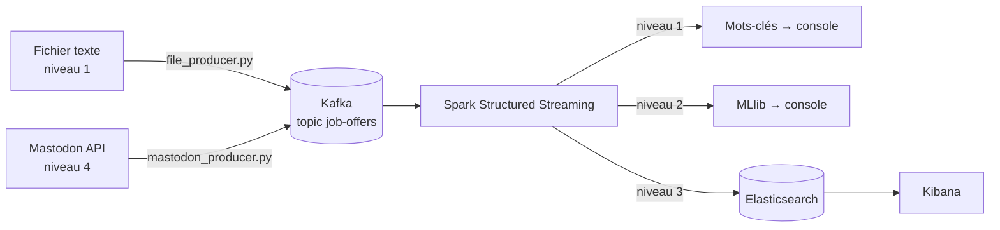

# Classification d'offres d'emploi en temps réel — Kafka × Spark Structured Streaming

Chaque offre d'emploi reçue en temps réel est classée dans l'un de ces domaines : **Data**, **Développement**, **Sécurité** ou **Cloud**.



## Structure

```
├── docker-compose.yml            Kafka (KRaft) + Elasticsearch + Kibana
├── requirements.txt
├── data/
│   ├── offres_stream.txt         offres envoyées par le producer (niveaux 1-3)
│   ├── train.csv                 jeu d'entraînement (généré)
│   └── test_reel.csv             38 offres étiquetées à la main (évaluation)
├── producer/
│   ├── file_producer.py          niveau 1 : fichier → Kafka
│   └── mastodon_producer.py      niveau 4 : Mastodon → Kafka
├── spark/
│   ├── common.py                 session Spark, lecture Kafka, mots-clés, modèle
│   ├── level1_keywords.py        niveau 1
│   ├── train_model.py            niveau 2 : entraînement MLlib
│   ├── level2_mllib_stream.py    niveau 2 : streaming MLlib
│   └── level3_elasticsearch.py   niveaux 3 et 4 : streaming → Elasticsearch
└── scripts/
    ├── generate_dataset.py       génère data/train.csv
    └── setup_kibana.py           crée la data view Kibana
```

## Prérequis

- **Docker** et Docker Compose.
- **Python 3.10 ou 3.11**. PySpark 3.5 n'est pas garanti en 3.12+.
- **Java 17** (ou 11), dans le `PATH`. Vérifier avec `java -version`.
- **Sous Windows, utiliser WSL2.** Spark en natif sous Windows demande `winutils.exe` pour les checkpoints, ce qui est source de nombreux problèmes.

```bash
python -m venv .venv && source .venv/bin/activate
pip install -r requirements.txt
docker compose up -d
docker exec kafka /opt/kafka/bin/kafka-topics.sh --create --topic job-offers \
  --bootstrap-server localhost:9092 --partitions 3 --replication-factor 1
```

Toutes les commandes se lancent **depuis la racine du projet**. Au premier lancement, Spark télécharge le connecteur Kafka, ce qui demande une connexion internet.

> **Ordre de lancement :** démarrer le job Spark **avant** le producer. Par défaut, Spark ne lit que les nouveaux messages (`startingOffsets=latest`). Pour relire tout le topic, utiliser `STARTING_OFFSETS=earliest`.
> Pour repartir de zéro, supprimer le dossier `checkpoints/` correspondant.

---

## Niveau 1 — Mots-clés

Terminal 1 :
```bash
python spark/level1_keywords.py
```
Terminal 2 :
```bash
python producer/file_producer.py --delay 1.5
```

Spark affiche des micro-batchs contenant l'heure, l'offre, la catégorie, le score et les mots-clés trouvés. Chaque catégorie possède une liste de mots-clés (voir `KEYWORDS` dans `common.py`). La catégorie retenue est celle qui en contient le plus. Si aucun mot-clé n'est trouvé, l'offre est classée `Inconnu`.

Pour vérifier ce qui transite par Kafka :
```bash
docker exec kafka /opt/kafka/bin/kafka-console-consumer.sh \
  --bootstrap-server localhost:9092 --topic job-offers --from-beginning
```

## Niveau 2 — Spark MLlib

```bash
python scripts/generate_dataset.py      # 4 000 offres étiquetées (1 000 par classe)
python spark/train_model.py             # entraîne, évalue et sauvegarde dans models/
python spark/level2_mllib_stream.py     # puis relancer le producer
```

Pour reproduire le split seedé, obtenir la matrice de confusion, les scores par classe,
le temps de fit et comparer les mots-clés sur le même test, lancer
`python spark/evaluate_model.py`. Ce script n'écrase pas le modèle sauvegardé.

**Pipeline MLlib :** `RegexTokenizer` → `StopWordsRemover` (FR + EN) → unigrammes et bigrammes (`NGram`) → `CountVectorizer` → `IDF` → `LogisticRegression` multinomiale → `IndexToString`.

Deux points de conception :
- Le `StringIndexer` est appliqué **avant** le pipeline. Le modèle sauvegardé n'a donc besoin que de la colonne `text`, ce qui est indispensable en streaming, puisqu'il n'y a pas de label en temps réel.
- Si la probabilité maximale est inférieure à `CONFIDENCE_THRESHOLD` (0,5 par défaut), la catégorie devient **`Incertain`**. C'est utile au niveau 4, où beaucoup de posts ne sont pas des offres d'emploi.

**Résultats obtenus :**

| Évaluation | MLlib | Mots-clés |
|---|---|---|
| Test 20 % du jeu synthétique | 1,00 | – |
| Jeu réel (`test_reel.csv`, 38 offres écrites à la main) | **0,89** | 0,79 |

Le score de 100 % sur le jeu synthétique est trompeur, car les gabarits sont trop réguliers. La mesure qui compte est celle du jeu réel. MLlib reconnaît des offres sans mot-clé explicite, par exemple « fiabiliser nos mises en production » classée Cloud. Il se trompe encore sur des cas ambigus, comme « Développeur sécurité applicative ». Pour l'améliorer, il faut ajouter des offres réelles étiquetées dans `train.csv`.

## Niveau 3 — Elasticsearch et Kibana

```bash
python spark/level3_elasticsearch.py    # puis relancer le producer
python scripts/setup_kibana.py          # crée la data view « Offres d'emploi »
```

Les documents sont écrits dans l'index `job-offers` via `foreachBatch` et l'API bulk du client Python. Chaque document contient les champs suivants : `@timestamp`, `text`, `category`, `predicted_label`, `confidence`, `kw_label`, `skills`, `source`, `url`, `author` et `agreement` (accord entre MLlib et les mots-clés).

Vérification rapide : `curl "localhost:9200/job-offers/_count"`.

**Construire le dashboard** sur http://localhost:5601 (menu Dashboards → Create dashboard → Create visualization, data view « Offres d'emploi ») :

1. **Donut** : répartition par `category`.
2. **Barres empilées dans le temps** : `@timestamp` en abscisse, découpé par `category`. Mettre le rafraîchissement automatique à 5 s pour voir le flux arriver en direct.
3. **Tag cloud** : top 30 de `skills`, c'est-à-dire les compétences les plus demandées.
4. **Barres** : `category` découpé par `kw_label`, pour comparer MLlib et les mots-clés.
5. **Métrique** : moyenne de `confidence` et nombre de documents.
6. **Table** : dernières offres (`text`, `category`, `confidence`, `source`, `url`).
7. **Filtre** : `source` (`file` ou `mastodon`).

## Niveau 4 — Temps réel depuis un réseau social

On utilise **Mastodon**, dont l'API publique est gratuite, contrairement à X/Twitter. Le producer interroge toutes les 15 s les hashtags d'emploi (`#hiring`, `#devjobs`, `#datajobs`, `#emploi`, `#recrutement`…). Il récupère uniquement les nouveaux posts grâce à `since_id`, convertit le HTML en texte et envoie un message JSON dans le même topic Kafka.

```bash
python spark/level3_elasticsearch.py        # même job Spark qu'au niveau 3
python producer/mastodon_producer.py --interval 15
```

Options utiles :
- `--tags hiring,devjobs,cloudjobs` pour choisir les hashtags.
- `--instance https://piaille.fr` pour changer d'instance (instance francophone).
- `--langs fr,en` pour filtrer les langues.

Si l'instance renvoie une erreur 401, il faut s'authentifier. Créer une application dans *Préférences → Développement* sur Mastodon, puis :
```bash
export MASTODON_TOKEN=xxxxxxxx
```

Spark lit indifféremment le texte brut (fichier) et le JSON (Mastodon), grâce à `get_json_object` combiné à `coalesce`. Le même job fonctionne donc avec les deux producers, qui peuvent même tourner **en même temps**.

## Niveau 5 — Capsule vidéo (5 à 7 min)

| Durée | Contenu |
|---|---|
| 0:00 – 0:45 | Problème : classer des offres en temps réel. Choix du cas d'usage. |
| 0:45 – 1:45 | Architecture (schéma ci-dessus) : rôle de Kafka, du topic et de Spark Structured Streaming (micro-batchs, checkpoints). |
| 1:45 – 2:45 | **Démo niveau 1** : deux terminaux côte à côte, producer et console Spark. Montrer un cas `Inconnu`. |
| 2:45 – 3:45 | **Niveau 2** : pipeline MLlib, résultats (tableau 0,89 contre 0,79), cas « fiabiliser nos mises en production » trouvé par MLlib et raté par les mots-clés. |
| 3:45 – 5:00 | **Niveaux 3 et 4** : lancer le producer Mastodon, montrer le dashboard Kibana se remplir en direct, le tag cloud des compétences et les posts `Incertain`. |
| 5:00 – 6:00 | Limites (données d'entraînement synthétiques, posts hors sujet) et améliorations (données réelles, modèle multilingue, Spark sur cluster). |

Conseil : lancer le producer une ou deux minutes avant l'enregistrement, pour que Kibana ait déjà des données à afficher.

## Dépannage

| Problème | Solution |
|---|---|
| `Failed to find data source: kafka` | La version de `pyspark` doit être 3.5.1, la même que `SPARK_VERSION` dans `common.py`. |
| `NoBrokersAvailable` | Kafka n'est pas démarré. Lancer `docker compose ps` et attendre une dizaine de secondes. |
| Rien ne s'affiche dans Spark | Le producer a été lancé avant Spark. Relancer le producer, ou utiliser `STARTING_OFFSETS=earliest`. |
| Elasticsearch s'arrête (exit 137) | Pas assez de RAM. Réduire `ES_JAVA_OPTS` à `-Xms512m -Xmx512m`. |
| Erreur liée aux checkpoints après une modification du code | Supprimer `checkpoints/levelX`. |
| `Java gateway process exited` | Java n'est pas installé ou pas dans le `PATH`. |
